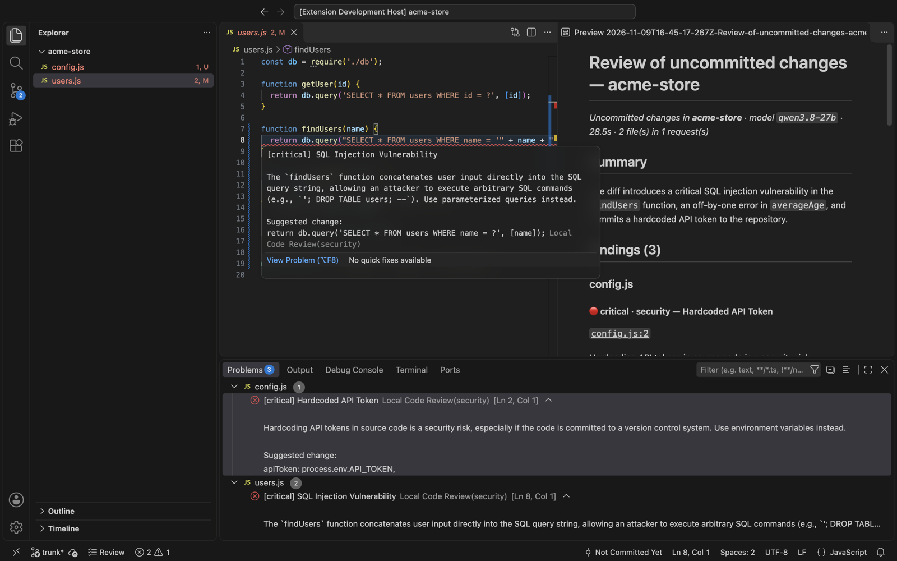
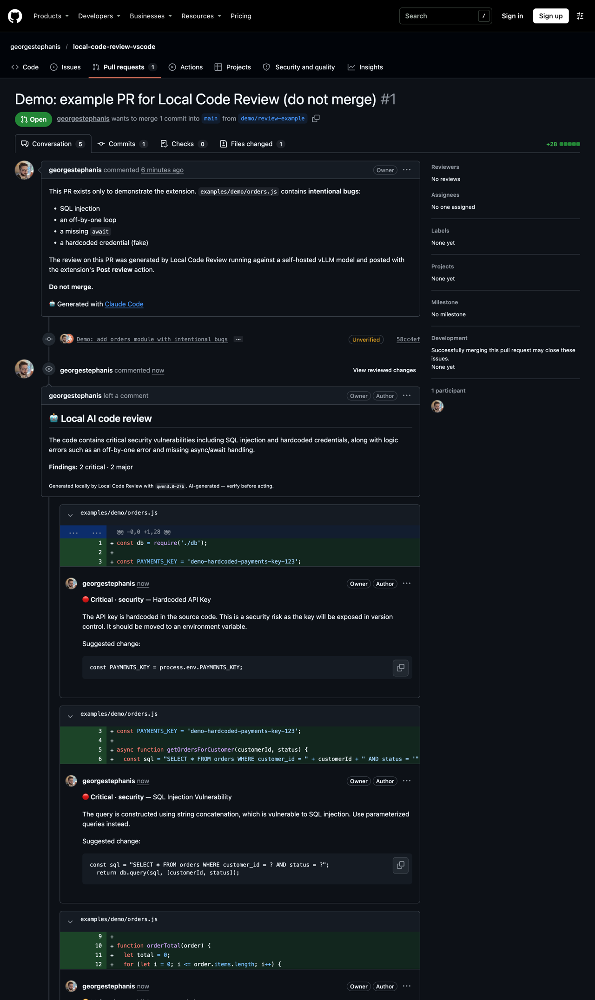
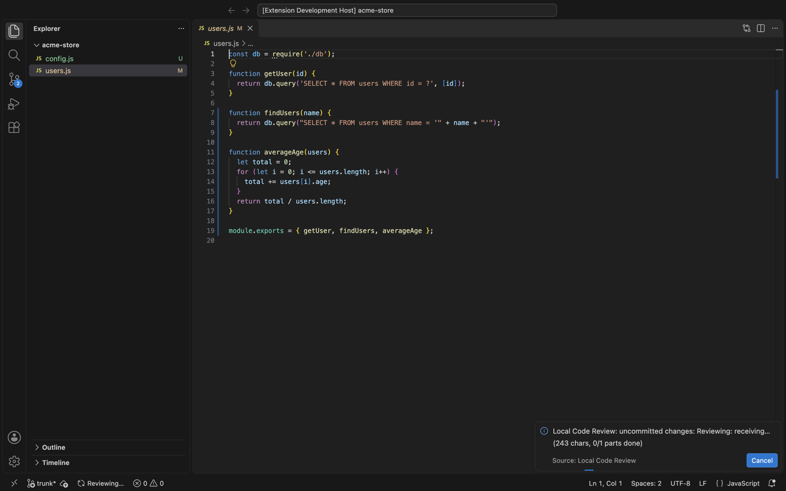
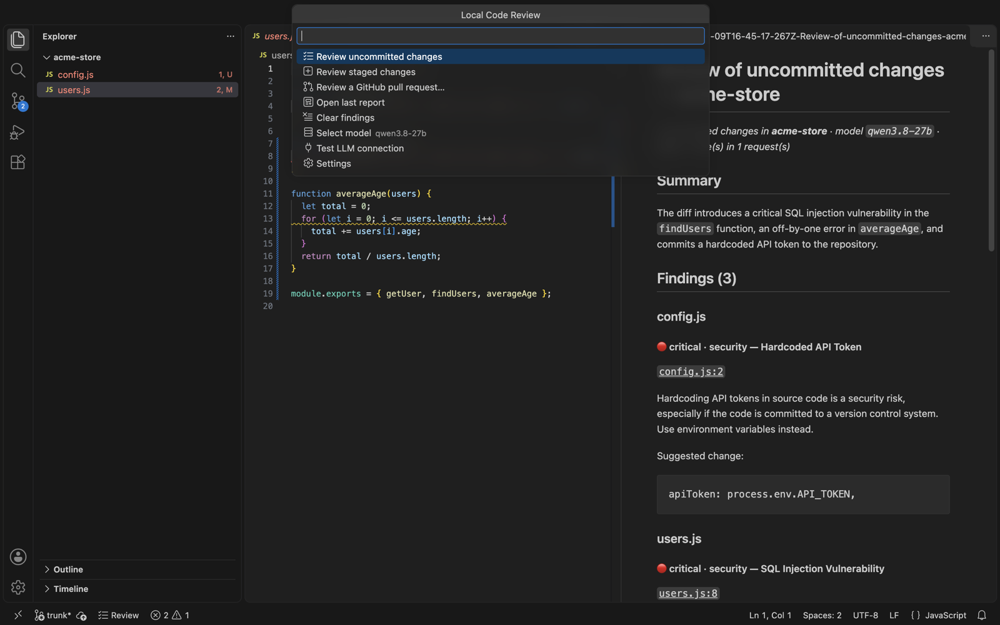
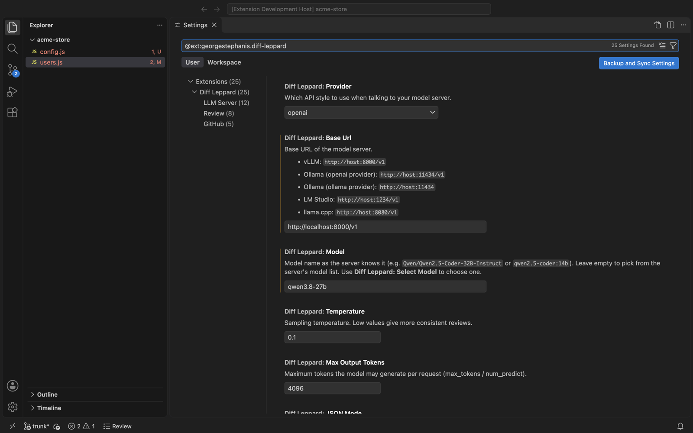

# Diff Leppard 🐆

> *Pour some suggestions on me.*

AI code review on **your own model server**. It works with vLLM, Ollama, LM Studio, llama.cpp, SGLang, LocalAI, or anything else that speaks the OpenAI `/v1/chat/completions` API. Your code goes only to your server, and to GitHub if you post the review.

It reviews **uncommitted or staged changes** or a **GitHub pull request**. It can post the result as a **real PR review**, with inline comments on the changed lines, as a submitted review, a "request changes", or a draft for you to edit first. Pick how you want to run it:

| | Use it for | Quick start |
| --- | --- | --- |
| 🧩 **VS Code extension** | Reviewing while you code: findings in the editor and Problems panel | [↓](#vs-code-extension) |
| ⌨️ **CLI**: `diff-leppard` | Terminals, scripts, pre-commit hooks, CI | [↓](#command-line) |
| 🐙 **`gh` extension**: `gh diff-leppard` | `gh diff-leppard 123 --post` from any checkout | [↓](#gh-extension) |
| 🤖 **GitHub Action** | Automatic reviews on PRs in any repo, or on demand with `/review` | [↓](#github-action) |
| 🪝 **pre-commit hook** | Review staged changes before commit, or pushed commits before push | [↓](#pre-commit) |
| ✳️ **Claude Code plugin** | Claude sets up and runs Diff Leppard for you, and gets a second opinion from your model on its own work | [↓](#claude-code-plugin) |

All of them share the same review engine, prompt and settings.



**The posted review on GitHub:** a summary plus inline comments. See it live on [demo PR #1](https://github.com/georgestephanis/diff-leppard/pull/1). Every finding there came from a self-hosted 27B model via vLLM.



## Connecting to your model server

Every flavor needs the same few settings:

| Server | `provider` | `baseUrl` |
| --- | --- | --- |
| vLLM (`vllm serve <model>`) | `openai` | `http://gpu-box:8000/v1` |
| Ollama | `ollama` (recommended) | `http://gpu-box:11434` |
| Ollama via its OpenAI endpoint | `openai` | `http://gpu-box:11434/v1` |
| LM Studio | `openai` | `http://localhost:1234/v1` |
| llama.cpp `llama-server` | `openai` | `http://localhost:8080/v1` |
| Any hosted OpenAI-compatible API | `openai` | its `/v1` URL |

Set `model` to the name the server knows. If you leave it empty and the server has only one model, that one is used. An API key, if needed, is sent as `Authorization: Bearer …`. Each flavor names these settings slightly differently:

| Setting | VS Code (`settings.json`) | CLI config file | Environment | Action input |
| --- | --- | --- | --- | --- |
| Server URL | `diffLeppard.baseUrl` | `baseUrl` | `DIFF_LEPPARD_BASE_URL` | `base-url` |
| Model | `diffLeppard.model` | `model` | `DIFF_LEPPARD_MODEL` | `model` |
| API key | *Set LLM API Key* command (secret storage) | `apiKey` | `DIFF_LEPPARD_API_KEY` | `api-key` |
| Extra request fields | `diffLeppard.extraBody` | `extraBody` | `DIFF_LEPPARD_EXTRA_BODY` | `extra-body` |
| Extra headers | `diffLeppard.extraHeaders` | `extraHeaders` | `DIFF_LEPPARD_EXTRA_HEADERS` | `extra-headers` |
| Diff chars per request (default: auto) | `diffLeppard.maxChunkChars` | `maxChunkChars` | `DIFF_LEPPARD_MAX_CHUNK_CHARS` | `max-chunk-chars` |

The full list is in [Settings reference](#settings-reference).

### Picking a model and sizing the context

The bigger and more code-focused the model, the better the review. A ~3B model mostly produces noise. 14B+ code or instruct models (Qwen2.5-Coder 14B/32B, Qwen3-Coder, Devstral, gpt-oss and so on) give useful results.

Large diffs are split into chunks, and by default **the chunk size is automatic**. Diff Leppard reads the model's context window from the server: vLLM's `max_model_len`, or `context_window` / `context_length` on others, and `ollamaNumCtx` for the native Ollama provider. It subtracts `maxOutputTokens` and the prompt, at about 3 characters per token, and caps chunks at 100,000 characters, because models review worse on huge prompts. If the server doesn't report a context window it uses 24,000 characters.

To size chunks yourself, set `maxChunkChars`. Roughly: (context window − `maxOutputTokens` − 1.5k) × 3.

| Context window | `maxChunkChars` |
| --- | --- |
| 8k | 8000 |
| 16k | 24000 |
| 32k | 60000 |
| 128k | 100000 |

**Ollama:** Ollama silently truncates prompts longer than its context window, which is small by default. Use `provider: "ollama"` so Diff Leppard can set `num_ctx` (`ollamaNumCtx`), or start Ollama with `OLLAMA_CONTEXT_LENGTH=16384`.

**Reasoning models** (Qwen3, DeepSeek-R1, gpt-oss, …) work too. `<think>` blocks and `reasoning` streams are ignored. However, they can think for thousands of tokens before they answer, which counts against `maxOutputTokens`. With guided JSON (`json_schema`), some never get to the answer at all. To skip the thinking on Qwen3-style models served by vLLM or SGLang:

```jsonc
"extraBody": { "chat_template_kwargs": { "enable_thinking": false } }
// Ollama: { "think": false }
```

In testing, a 27B Qwen model with thinking off reviewed a small diff in about 30 seconds. With thinking on it took about 3.5 minutes. Both runs flagged the SQL injection, the off-by-one and the hardcoded secret on the right lines.

## VS Code extension

### Install

```bash
git clone https://github.com/georgestephanis/diff-leppard && cd diff-leppard
npm install
npm run package                             # -> diff-leppard.vsix
code --install-extension diff-leppard.vsix  # or: Extensions view → … → Install from VSIX
```

Next, open **Settings → Extensions → Diff Leppard** and run **Diff Leppard: Test LLM Connection**. Leave `model` empty to choose from the server's list, or run **Select Model**.

```jsonc
// settings.json
{
  "diffLeppard.baseUrl": "http://gpu-box:8000/v1",
  "diffLeppard.model": "Qwen/Qwen2.5-Coder-32B-Instruct",
  "diffLeppard.concurrency": 2,         // vLLM batches concurrent requests well
  "diffLeppard.extraBody": { "chat_template_kwargs": { "enable_thinking": false } }
}
```

### Commands

| Command | What it does |
| --- | --- |
| **Review Uncommitted Changes** | `git diff HEAD` plus untracked files. Also a ✓ button in the Source Control title bar and a **Review** item in the status bar. |
| **Review Staged Changes** | `git diff --cached` |
| **Review GitHub Pull Request…** | Pick an open PR from the `upstream`/`origin` GitHub remote, or type `123`, `owner/repo#123`, or a PR URL |
| **Post Last Review to GitHub** | Post (or re-post) the last PR review: comment, request changes, or pending/draft |
| **Open Last Review Report** | Re-open the Markdown report |
| **Clear Findings** | Remove findings from the Problems panel |
| Select Model / Test LLM Connection / Set LLM API Key | Setup helpers |

Each review writes a Markdown report and opens it beside your code. Local reviews also put findings in the **Problems** panel (critical = error, major = warning, minor = info, nit = hint). A PR review does the same when your local `HEAD` is the PR's head commit. Raw prompts and model output are logged to the **Diff Leppard** output channel at Debug level (`Developer: Set Log Level…`).

When a PR review finishes you're asked whether to post it (`diffLeppard.github.postReview`: `ask` | `always` | `never`). GitHub sign-in uses VS Code's built-in account (scope `repo`). If your org blocks VS Code's OAuth app, set `diffLeppard.github.auth` to `gh-cli`.

<details>
<summary>More screenshots</summary>

Progress while the model is working (cancellable):



The status bar **Review** menu:



Settings:



</details>

## Command line

The CLI has no runtime dependencies:

```bash
npm install -g https://github.com/georgestephanis/diff-leppard/releases/latest/download/diff-leppard.tgz   # installs `diff-leppard`

diff-leppard test                     # check the server connection
diff-leppard pr 123                   # review PR #123 of the current repo (asks whether to post)
diff-leppard pr owner/repo#123 --post # review and post as a comment review
diff-leppard pr --draft               # PR for the current branch → pending review you edit on GitHub
diff-leppard local                    # uncommitted changes in the current repo
diff-leppard local --staged --fail-on major   # pre-commit / CI style: exit 1 on major+ findings
diff-leppard local --base main        # everything on this branch since it left main (committed + uncommitted)
diff-leppard local --range v1.0.0..HEAD   # exactly these commits (a...b = since their merge-base)
diff-leppard pr 123 -f json           # machine-readable output (also: -f markdown, -o report.md)
```

Settings are read in this order, each overriding the one before:

1. `~/.config/diff-leppard/config.json` (yours; may hold `apiKey`)
2. `<repo>/.diff-leppard.json`, shared per repo. It may only set review preferences: `model`, `temperature`, `maxChunkChars`, `contextLines`, `includeUntracked`, `minimumSeverity`, `excludeGlobs`, `extraInstructions` and `instructionsFile`. Other keys are ignored with a warning. For PR reviews it's read from the PR's **base** branch, so a PR can't change where your credentials go or how it is reviewed.
3. `DIFF_LEPPARD_*` environment variables
4. command-line flags

```jsonc
// ~/.config/diff-leppard/config.json
{
  "baseUrl": "http://gpu-box:8000/v1",
  "model": "Qwen/Qwen2.5-Coder-32B-Instruct",
  "apiKey": "…",
  "extraBody": { "chat_template_kwargs": { "enable_thinking": false } }
}
```

Run `diff-leppard config` to see the effective settings, with secrets redacted, and where each came from. For GitHub the CLI uses `GH_TOKEN`/`GITHUB_TOKEN`, or else `gh auth token`. `diff-leppard --help` lists every flag and environment variable.

The exit codes are:

- `0`: success
- `1`: findings at or above `--fail-on`
- `2`: error, or the review was incomplete because some parts failed
- `130`: cancelled

## `gh` extension

```bash
git clone https://github.com/georgestephanis/diff-leppard
cd diff-leppard/gh-diff-leppard && gh extension install .   # needs only Node; dist/ is prebuilt

gh diff-leppard              # PR for the current branch
gh diff-leppard 123 --post
gh diff-leppard local        # uncommitted changes
```

It takes the same flags and config as the CLI. Set `DIFF_LEPPARD_BIN` to point it at a specific CLI build. If you'd rather not install an extension, an alias does the same once the CLI is on your `PATH`: `gh alias set --shell review 'diff-leppard pr "$@"'`, then `gh review 123`.

## GitHub Action

Any repository can have PRs reviewed by any OpenAI-compatible host. Copy [`examples/workflows/diff-leppard.yml`](examples/workflows/diff-leppard.yml) into `.github/workflows/`, then set:

- `LLM_BASE_URL`, e.g. `https://llm.example.com/v1`. Make this a **secret** if the address is private. Public repos have public logs, and GitHub prints a step's inputs, which are only masked when they come from secrets. A plain **variable** also works; the secret wins if both exist.
- **variable** `LLM_MODEL` (optional)
- **secret** `LLM_API_KEY` (optional)

Org-level secrets and variables work too, so one model server can serve many repos (`gh secret set LLM_API_KEY --org my-org --repos a,b`).

The core of it:

```yaml
permissions:
  contents: read
  pull-requests: write
jobs:
  review:
    runs-on: ubuntu-latest
    steps:
      - uses: georgestephanis/diff-leppard@v1
        with:
          base-url: ${{ secrets.LLM_BASE_URL || vars.LLM_BASE_URL }}
          model: ${{ vars.LLM_MODEL }}
          api-key: ${{ secrets.LLM_API_KEY }}
          review-event: comment      # comment | request-changes | none
          # attribution: false       # drop the "Review generated by Diff Leppard" footer
          # fail-on: critical
          # extra-body: '{"chat_template_kwargs": {"enable_thinking": false}}'
```

The example workflow reviews PRs when they're opened or marked ready. Maintainers can also request a review by commenting **`/review`** on a PR, or run it by hand from the Actions tab. The review is posted by `github-actions[bot]`. It also appears in the job summary and as annotations. The `findings`, `blocking` and `report` outputs let later steps act on the result.

Things to know:

- **The runner must be able to reach your model server.** For a server on a private network, either:
  - use a self-hosted runner on that network, or
  - join the network from the job (the example has a commented [Tailscale](https://github.com/tailscale/github-action) step), or
  - expose the server over HTTPS behind an API key or an auth proxy (put proxy headers in `extra-headers` from secrets).
- **Fork PRs don't get secrets** on `pull_request` events. The example skips them; a maintainer can `/review` instead. The action never checks out or runs PR code. It reads the diff through the API, and the workflow only needs `contents: read` and `pull-requests: write`.
- **Inputs:** `base-url`, `model`, `api-key`, `provider`, `extra-headers`, `extra-body`, `json-mode`, `review-event`, `attribution`, `min-severity`, `fail-on`, `max-chunk-chars`, `max-output-tokens`, `concurrency`, `timeout-seconds`, `extra-instructions`, `pr-number`, `repository`, `github-token`. See [`action.yml`](action.yml).

## pre-commit

Add Diff Leppard to [pre-commit](https://pre-commit.com). At the `pre-commit` stage it reviews your staged changes; at `pre-push` it reviews the commits being pushed. A review takes seconds to minutes, so `pre-push` or `manual` usually suit it better than every commit.

```yaml
# .pre-commit-config.yaml
repos:
  - repo: https://github.com/georgestephanis/diff-leppard
    rev: v1.1.0
    hooks:
      - id: diff-leppard            # or diff-leppard-system to use the diff-leppard on your PATH
        stages: [pre-push]
        args: [--fail-on, critical] # block the push on critical findings (the default)
```

It uses your normal config (`~/.config/diff-leppard/config.json` or `DIFF_LEPPARD_*`). Run it on demand with `pre-commit run diff-leppard --hook-stage manual`. Outside pre-commit, `diff-leppard hook` does the same thing.

## Claude Code plugin

The plugin adds a skill that teaches Claude Code to install, configure and troubleshoot Diff Leppard and to run reviews with it. That includes asking your self-hosted model for a **second opinion on Claude's own changes**: Claude checks each finding against the code, fixes the real problems and tells you what it dismissed.

```
/plugin install diff-leppard --marketplace georgestephanis/diff-leppard
```

On older Claude Code versions, run `/plugin marketplace add georgestephanis/diff-leppard`, then `/plugin install diff-leppard@diff-leppard`. The skill is in [`skills/diff-leppard/SKILL.md`](skills/diff-leppard/SKILL.md).

## How posted reviews work

This applies to every flavor:

- Findings on lines that are part of the diff become **inline comments**. Anything else (file-level notes, lines outside the diff) goes in the review body.
- If the model is off by a line or two, the comment snaps to the nearest changed line. If GitHub still rejects an inline position, Diff Leppard re-posts with everything in the body, so the review isn't lost.
- **Comment** posts a normal review.
- **Request changes** does so only when something is critical or major. GitHub won't let you request changes on your own PR, so then it posts a comment instead.
- **Draft (pending)** creates a review only you can see. Delete or edit the AI's comments on GitHub, then submit it as yourself. This is the best mode while you're getting to know a model.
- Turn on `github.suggestionBlocks` to render proposed fixes as one-click ```` ```suggestion ```` blocks. It's off by default because local models often get the exact line range slightly wrong.
- **Attribution:** reviews end with "Review generated by [Diff Leppard](https://github.com/georgestephanis/diff-leppard), running `<model>`". Set `github.attribution` to `false` (or the Action's `attribution: false`) to drop it.
- **GitHub Enterprise Server:** set `github.apiUrl` to `https://your-host/api/v3`. In VS Code, also set `github-enterprise.uri`, or use `gh-cli` auth. The CLI uses `GH_ENTERPRISE_TOKEN` for non-github.com hosts and never sends a github.com token elsewhere.

## Project-specific guidelines

Add `.github/code-review-instructions.md` (configurable via `instructionsFile`) to a repo and its contents get added to the prompt. For PRs it's read from the base branch. For example:

```md
- This is a WordPress plugin. Flag output that isn't escaped (esc_html, esc_attr, wp_kses), missing nonce checks, and missing capability checks.
- Don't comment on PHPCS formatting; CI enforces it.
```

For personal or global rules, use `extraInstructions` (or the Action's `extra-instructions` input).

## Settings reference

The names below are CLI config keys:

- **VS Code:** prefix them with `diffLeppard.`.
- **Environment variables:** use `DIFF_LEPPARD_` plus the upper-snake-case name, for example `DIFF_LEPPARD_MAX_CHUNK_CHARS`. `github.*` keys become `DIFF_LEPPARD_GITHUB_*`, for example `DIFF_LEPPARD_GITHUB_ATTRIBUTION=false`.
- **Validation:** values are checked, so `concurrency: "abc"` is an error rather than a silent no-op.

| Key | Default | |
| --- | --- | --- |
| `provider` | `openai` | `openai` or `ollama` (native API) |
| `baseUrl` | `http://localhost:8000/v1` | |
| `model` | *(server's only model)* | |
| `temperature` | `0.1` | |
| `maxOutputTokens` | `4096` | |
| `jsonMode` | `json_object` | `json_object`, `json_schema` or `none`. Falls back to `none` automatically if the server refuses. |
| `stream` | `true` | Keep it on. Node aborts non-streamed requests whose headers take more than 5 minutes. |
| `requestTimeoutSeconds` | `900` | |
| `concurrency` | `1` | Parallel requests (2–4 is fine on vLLM) |
| `ollamaNumCtx` | `16384` | |
| `extraHeaders`, `extraBody` | `{}` | Merged into every request |
| `maxChunkChars` | `0` (auto) | Sized to the model's context window; see [sizing](#picking-a-model-and-sizing-the-context) |
| `contextLines` | `5` | Context lines in local diffs |
| `includeUntracked` | `true` | |
| `minimumSeverity` | `minor` | `critical`, `major`, `minor` or `nit` |
| `excludeGlobs` | lockfiles, minified, `dist/`, `vendor/`… | |
| `extraInstructions`, `instructionsFile` | `""`, `.github/code-review-instructions.md` | |
| `github.apiUrl`, `github.reviewEvent`, `github.suggestionBlocks` | `https://api.github.com`, `COMMENT`, `false` | `reviewEvent` is what `--post` and the posting prompt use |
| `github.attribution` | `true` | End posted reviews with "Review generated by Diff Leppard, running `<model>`" |

## Troubleshooting

- **"Could not reach …"**: check `baseUrl`. OpenAI-compatible servers need the `/v1` suffix. Try `curl <baseUrl>/models`.
- **"Model did not return parseable JSON"**: the model ignored the format. Try `jsonMode: json_schema` (vLLM, recent Ollama, LM Studio), a stronger model, or a lower temperature. Check the debug log for the raw reply: the VS Code output channel at Debug level, or `DIFF_LEPPARD_DEBUG=1` for the CLI.
- **Output cut off**: raise `maxOutputTokens`. Diff Leppard salvages complete findings from cut-off JSON, but it logs a warning.
- **"The model got stuck repeating itself … stopped it early"**: the model fell into a loop, so Diff Leppard cut it off instead of letting it run to `maxOutputTokens`, and kept whatever findings parsed. If it happens often, raise `temperature` slightly (0.2–0.3 loops less often than 0–0.1), try `jsonMode: json_schema`, or add a repetition penalty with `extraBody`, such as `{"repetition_penalty": 1.05}` on vLLM.
- **Slow or timing out**: turn off thinking (see [Reasoning models](#picking-a-model-and-sizing-the-context)), set a smaller `maxChunkChars`, or raise `requestTimeoutSeconds`.
- **"Prompt too long" / context-length errors**: the server's reported context is larger than what it actually serves (or `maxOutputTokens` is high). Set `maxChunkChars` explicitly.

## Contributing

See [AGENTS.md](AGENTS.md) for the architecture, conventions and test commands. It's written for AI coding agents but works just as well for humans.

```bash
npm install
npm test                # unit, mock-server and CLI tests (node:test)
npm run test:vscode     # runs the extension inside a real VS Code
npm run cli -- --help   # the CLI from source
```

## License

[GPL-3.0-or-later](LICENSE) © George Stephanis
