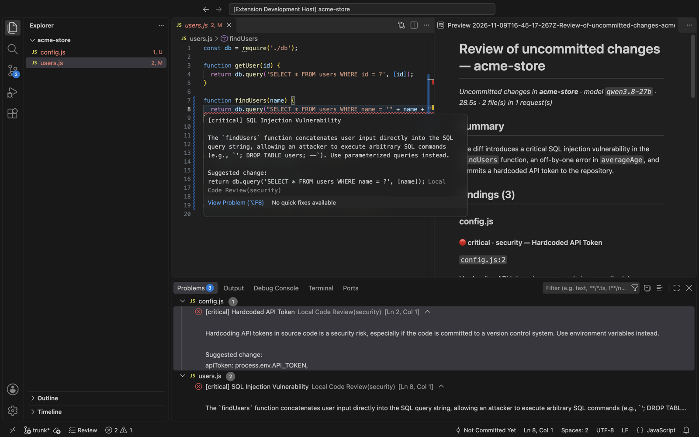
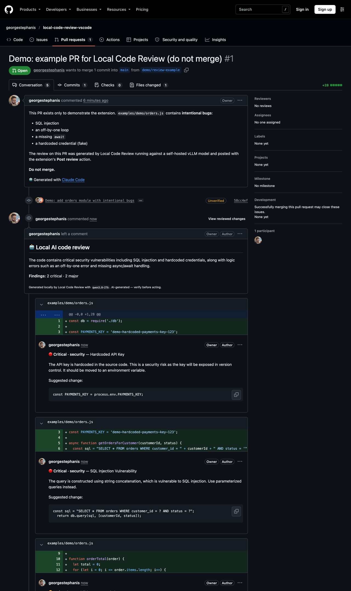
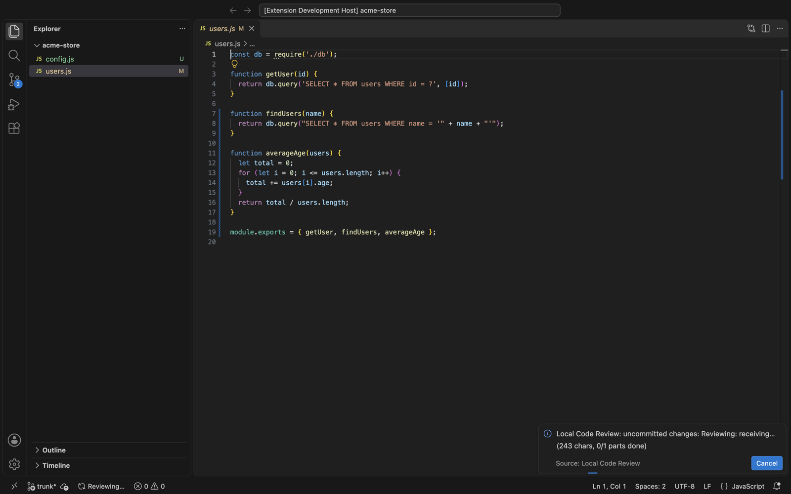
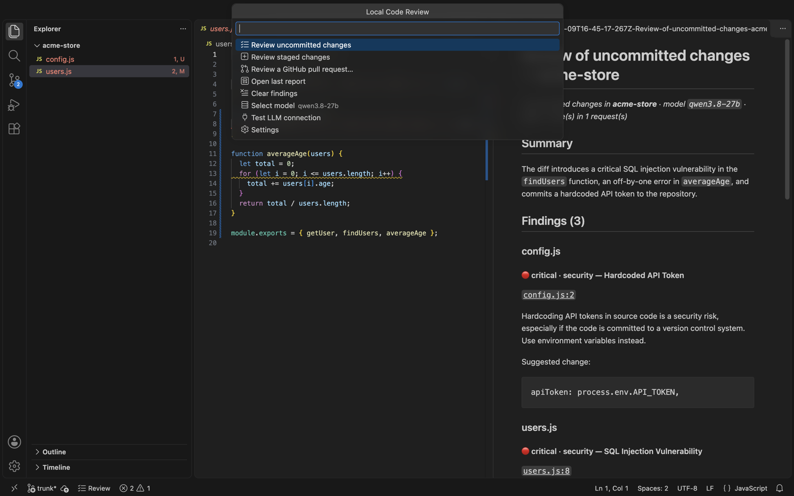
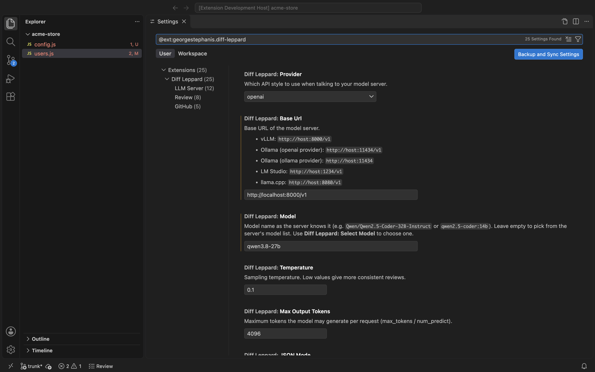

# Diff Leppard 🐆

> [!TIP]
> **Look before you build.** [wvw.dev](https://wvw.dev) is a catalog of open-source apps, many of them built with AI.
> When this was written, nothing there did code review. The closest is [git-rewrite-commits](https://wvw.dev/#/discover/git-rewrite-commits) (rewrites commit messages with Ollama or GPT). Before spending tokens on a new app, search wvw.dev for something you can fork (or fork this one).

> *Pour some suggestions on me.*

AI code review on **your own model server**. It works with vLLM, Ollama, LM Studio, llama.cpp, SGLang, LocalAI, or anything else that speaks the OpenAI `/v1/chat/completions` API. Your code goes only to your server, and to GitHub if you post the review.

It reviews **uncommitted or staged changes** or a **GitHub pull request**. It can post the result as a **real PR review**, with inline comments on the changed lines, as a submitted review, a "request changes", or a draft for you to edit first. Pick how you want to run it:

| | Use it for | Quick start |
| --- | --- | --- |
| 🧩 **VS Code extension** | Reviewing while you code: findings in the editor and Problems panel | [↓](#vs-code-extension) |
| ⌨️ **CLI**: `diff-leppard` | Terminals, scripts, pre-commit hooks, CI | [↓](#command-line) |
| 🐙 **`gh` extension**: `gh diff-leppard` | `gh diff-leppard 123 --post` from any checkout | [↓](#gh-extension) |
| 🤖 **GitHub Action** | Automatic reviews on PRs in any repo, or on demand with `/review` | [↓](#github-action) |
| 👀 **`diff-leppard watch`** | Automatic draft reviews for every PR that requests your review, in any repo, from your own machine | [↓](#watch-automatic-reviews-across-all-your-repos) |
| 🪝 **pre-commit hook** | Review staged changes before commit, or pushed commits before push | [↓](#pre-commit) |
| 🌙 **Neovim plugin** | Findings as diagnostics and in the quickfix list, from `:DiffLeppard` | [↓](#neovim) |
| 🔌 **MCP server**: `diff-leppard mcp` | Any agent (Cursor, Copilot, Claude Desktop, Claude Code, …) asks your model for a review | [↓](#mcp-server) |
| ✳️ **Claude Code plugin** | Claude sets up and runs Diff Leppard for you, and gets a second opinion from your model on its own work | [↓](#claude-code-plugin) |

All of them share the same review engine, prompt and settings.



**The posted review on GitHub:** a summary plus inline comments. See it live on [demo PR #1](https://github.com/georgestephanis/diff-leppard/pull/1). Every finding there came from a self-hosted 27B model via vLLM.



## Connecting to your model server

Every flavor needs the same few settings:

| Server | `provider` | `baseUrl` |
| --- | --- | --- |
| vLLM (`vllm serve <model>`) | `openai` | `http://gpu-box:8000/v1` |
| Ollama | `ollama` (recommended) | `http://gpu-box:11434` |
| Ollama via its OpenAI endpoint | `openai` | `http://gpu-box:11434/v1` |
| LM Studio | `openai` | `http://localhost:1234/v1` |
| llama.cpp `llama-server` | `openai` | `http://localhost:8080/v1` |
| Any hosted OpenAI-compatible API | `openai` | its `/v1` URL |

Set `model` to the name the server knows. If you leave it empty and the server has only one model, that one is used. An API key, if needed, is sent as `Authorization: Bearer …`. Each flavor names these settings slightly differently:

| Setting | VS Code (`settings.json`) | CLI config file | Environment | Action input |
| --- | --- | --- | --- | --- |
| Server URL | `diffLeppard.baseUrl` | `baseUrl` | `DIFF_LEPPARD_BASE_URL` | `base-url` |
| Model | `diffLeppard.model` | `model` | `DIFF_LEPPARD_MODEL` | `model` |
| API key | *Set LLM API Key* command (secret storage) | `apiKey` | `DIFF_LEPPARD_API_KEY` | `api-key` |
| Extra request fields | `diffLeppard.extraBody` | `extraBody` | `DIFF_LEPPARD_EXTRA_BODY` | `extra-body` |
| Extra headers | `diffLeppard.extraHeaders` | `extraHeaders` | `DIFF_LEPPARD_EXTRA_HEADERS` | `extra-headers` |
| Characters per request (default: auto) | `diffLeppard.maxChunkChars` | `maxChunkChars` | `DIFF_LEPPARD_MAX_CHUNK_CHARS` | `max-chunk-chars` |

The full list is in [Settings reference](#settings-reference).

### Picking a model and sizing the context

The bigger and more code-focused the model, the better the review. A ~3B model mostly produces noise. 14B+ code or instruct models (Qwen2.5-Coder 14B/32B, Qwen3-Coder, Devstral, gpt-oss and so on) give useful results.

Large diffs are split into chunks, and by default **the chunk size is automatic**. Diff Leppard reads the model's context window from the server: vLLM's `max_model_len`, or `context_window` / `context_length` on others, and `ollamaNumCtx` for the native Ollama provider. It subtracts `maxOutputTokens` and the prompt, at about 3 characters per token, and caps chunks at 100,000 characters, because models review worse on huge prompts. If the server doesn't report a context window it uses 24,000 characters.

To size chunks yourself, set `maxChunkChars`. Roughly: (context window − `maxOutputTokens` − 1.5k) × 3.

| Context window | `maxChunkChars` |
| --- | --- |
| 8k | 8000 |
| 16k | 24000 |
| 32k | 60000 |
| 128k | 100000 |

**Ollama:** Ollama silently truncates prompts longer than its context window, which is small by default. Use `provider: "ollama"` so Diff Leppard can set `num_ctx` (`ollamaNumCtx`), or start Ollama with `OLLAMA_CONTEXT_LENGTH=16384`.

**Reasoning models** (Qwen3, DeepSeek-R1, gpt-oss, …) work too. `<think>` blocks and `reasoning` streams are ignored. However, they can think for thousands of tokens before they answer, which counts against `maxOutputTokens`. With guided JSON (`json_schema`), some never get to the answer at all. To skip the thinking on Qwen3-style models served by vLLM or SGLang:

```jsonc
"extraBody": { "chat_template_kwargs": { "enable_thinking": false } }
// Ollama: { "think": false }
```

In testing, a 27B Qwen model with thinking off reviewed a small diff in about 30 seconds. With thinking on it took about 3.5 minutes. Both runs flagged the SQL injection, the off-by-one and the hardcoded secret on the right lines.

### What the model sees

A diff alone hides many real problems: a new CSS rule that ties with one 150 lines up, an `` guard a few lines above a link, a README saying the data folder a script reads is out of date. So each request carries more than the hunks, sized from the same context budget:

1. **Review guidelines**: `instructionsFile`, or else the first of `instructionsFallback` that exists (`AGENTS.md`, `CLAUDE.md`, `.github/copilot-instructions.md`, `CONTRIBUTING.md`). Long guides are trimmed to their headings plus the sections about reviews, tests, deploys and data. Up to `maxInstructionsChars`, and at most 15% of the request.
2. **Surrounding code**: each changed file is shown whole when it fits in `fullFileMaxChars` (and 80% of the room left for the diff). Bigger files get their hunks widened by as many lines as fit. Unchanged lines are marked as context; comments still land on changed lines.
3. **Related code**: names the change uses (functions, CSS classes, flags, constants) are searched for in the rest of the repo, and folders it names are listed with their README and the last commit that touched them. Other files come first, then docs and tests. Up to `relatedMaxChars`, at most 20% of the request. This needs the reviewed commit locally: local reviews always have it, and `pr` does when run from a clone that has fetched the PR head. `watch`, and the GitHub Action unless the workflow fetches the PR head, read PRs through the API, so they skip it (see [Platform differences](#platform-differences)).
4. **Description check** (off by default): the PR description (for `local --range` and `--base`, the commit messages; `--title` and `--description` set them explicitly) is checked against the diff, and claims the code doesn't support are reported (`checkDescription`). This only happens when the whole change fits in one request, since a part of a split review can't see the code that might back a claim.

With a small context window these shrink so the diff keeps most of the room; with a large one they fill up to their caps. `maxChunkChars`, automatic or set by you, is the size of one whole request, so guidelines and related code come out of it too. `--no-context` turns off whole files, related code and the `AGENTS.md` fallback; a configured `instructionsFile` is still used, as before, and verification may still read a file that a finding names.

After the review, critical and major findings get a **second look** (`verifyFindings`): a separate request with the code around the finding must confirm it and quote the lines that prove it. Rejected findings are dropped (listed in `-v` output and in JSON as `rejectedFindings`); findings it can't decide are kept one severity lower. A finding on a file the change didn't touch (models often blame a file they only saw as context) is checked against that file, read from the reviewed version of the repo, together with the change; one that names no file is checked against the whole change; one with no code to check against is lowered one step. Set `verifyFindings` to `all` to check every finding, or `off`.

All of this makes reviews slower than plain hunks: bigger requests, plus one more request per serious finding. In testing with a 27B model, reviews took about twice as long per range (a rough comparison: one 1.3.0 run, on a different set of ranges), and false critical and major findings went from 5 in a 1.3.0 run to none in each of 3 runs. For quick reviews, `--verify off` drops the second look and `--no-context` sends hunks only.

**Experimental: `--agentic`** (`agentic: true`) lets the model call read-only tools before answering: `read_file` (also the version before the change), `grep` and `list_dir`, confined to the repository at the reviewed commit, with at most `maxToolCalls` calls and tool output capped by the context budget. It needs a server with tool calling (vLLM with `--enable-auto-tool-choice` and a tool parser, SGLang, LM Studio, recent Ollama) and falls back to a normal review if the server refuses tools. It needs the reviewed commit locally, like related code, and isn't available in VS Code. In testing with a 27B model it found nothing more, the model rarely used the tools, and it was slower ([#35](https://github.com/georgestephanis/diff-leppard/issues/35)).

## VS Code extension

### Install

```bash
git clone https://github.com/georgestephanis/diff-leppard && cd diff-leppard
npm install
npm run package                             # -> diff-leppard.vsix
code --install-extension diff-leppard.vsix  # or: Extensions view → … → Install from VSIX
```

Next, open **Settings → Extensions → Diff Leppard** and run **Diff Leppard: Test LLM Connection**. Leave `model` empty to choose from the server's list, or run **Select Model**.

```jsonc
// settings.json
{
  "diffLeppard.baseUrl": "http://gpu-box:8000/v1",
  "diffLeppard.model": "Qwen/Qwen2.5-Coder-32B-Instruct",
  "diffLeppard.concurrency": 2,         // vLLM batches concurrent requests well
  "diffLeppard.extraBody": { "chat_template_kwargs": { "enable_thinking": false } }
}
```

### Commands

| Command | What it does |
| --- | --- |
| **Review Uncommitted Changes** | `git diff HEAD` plus untracked files. Also a ✓ button in the Source Control title bar and a **Review** item in the status bar. |
| **Review Staged Changes** | `git diff --cached` |
| **Review GitHub Pull Request…** | Pick an open PR from the `upstream`/`origin` GitHub remote, or type `123`, `owner/repo#123`, or a PR URL |
| **Post Last Review to GitHub** | Post (or re-post) the last PR review: comment, request changes, or pending/draft |
| **Open Last Review Report** | Re-open the Markdown report |
| **Clear Findings** | Remove findings from the Problems panel |
| Select Model / Test LLM Connection / Set LLM API Key | Setup helpers |

Each review writes a Markdown report and opens it beside your code. Local reviews also put findings in the **Problems** panel (critical = error, major = warning, minor = info, nit = hint). A PR review does the same when your local `HEAD` is the PR's head commit. Raw prompts and model output are logged to the **Diff Leppard** output channel at Debug level (`Developer: Set Log Level…`).

When a PR review finishes you're asked whether to post it (`diffLeppard.github.postReview`: `ask` | `always` | `never`). GitHub sign-in uses VS Code's built-in account (scope `repo`). If your org blocks VS Code's OAuth app, set `diffLeppard.github.auth` to `gh-cli`.

<details>
<summary>More screenshots</summary>

Progress while the model is working (cancellable):



The status bar **Review** menu:



Settings:



</details>

## Command line

The CLI has no runtime dependencies:

```bash
npm install -g https://github.com/georgestephanis/diff-leppard/releases/latest/download/diff-leppard.tgz   # installs `diff-leppard`

diff-leppard test                     # check the server connection
diff-leppard pr 123                   # review PR #123 of the current repo (asks whether to post)
diff-leppard pr owner/repo#123 --post # review and post as a comment review
diff-leppard pr --draft               # PR for the current branch → pending review you edit on GitHub
diff-leppard local                    # uncommitted changes in the current repo
diff-leppard local --staged --fail-on major   # pre-commit / CI style: exit 1 on major+ findings
diff-leppard local --base main        # everything on this branch since it left main (committed + uncommitted)
diff-leppard local --range v1.0.0..HEAD   # exactly these commits (a...b = since their merge-base)
diff-leppard pr 123 -f json           # machine-readable output (also -f markdown, sarif, rdjson; -o report.md)
diff-leppard local --description @PLAN.md   # tell the model what the change is for (also --title; @- reads stdin)
diff-leppard local --verify off --no-context  # quick pass: no second look, hunks only
```

Settings are read in this order, each overriding the one before:

1. `~/.config/diff-leppard/config.json` (yours; may hold `apiKey`)
2. `<repo>/.diff-leppard.json`, shared per repo. It may only set review preferences: `model`, `temperature`, `maxChunkChars`, `contextLines`, `includeUntracked`, `minimumSeverity`, `excludeGlobs`, `extraInstructions`, `instructionsFile`, `instructionsFallback`, `maxInstructionsChars`, `fullFileMaxChars`, `relatedMaxChars` and `checkDescription`. Other keys are ignored with a warning. For PR reviews it's read from the PR's **base** branch, so a PR can't change where your credentials go or how it is reviewed.
3. `DIFF_LEPPARD_*` environment variables
4. command-line flags

```jsonc
// ~/.config/diff-leppard/config.json
{
  "baseUrl": "http://gpu-box:8000/v1",
  "model": "Qwen/Qwen2.5-Coder-32B-Instruct",
  "apiKey": "…",
  "extraBody": { "chat_template_kwargs": { "enable_thinking": false } }
}
```

Run `diff-leppard config` to see the effective settings, with secrets redacted, and where each came from. For GitHub the CLI uses `GH_TOKEN`/`GITHUB_TOKEN`, or else `gh auth token`. `diff-leppard --help` lists every flag and environment variable.

The exit codes are:

- `0`: success
- `1`: findings at or above `--fail-on`
- `2`: error, or the review was incomplete because some parts failed
- `130`: cancelled

## `gh` extension

```bash
git clone https://github.com/georgestephanis/diff-leppard
cd diff-leppard/gh-diff-leppard && gh extension install .   # needs only Node; dist/ is prebuilt

gh diff-leppard              # PR for the current branch
gh diff-leppard 123 --post
gh diff-leppard local        # uncommitted changes
```

It takes the same flags and config as the CLI. Set `DIFF_LEPPARD_BIN` to point it at a specific CLI build. If you'd rather not install an extension, an alias does the same once the CLI is on your `PATH`: `gh alias set --shell review 'diff-leppard pr "$@"'`, then `gh review 123`.

## GitHub Action

Any repository can have PRs reviewed by any OpenAI-compatible host. Copy [`examples/workflows/diff-leppard.yml`](examples/workflows/diff-leppard.yml) into `.github/workflows/`, then set:

- `LLM_BASE_URL`, e.g. `https://llm.example.com/v1`. Make this a **secret** if the address is private. Public repos have public logs, and GitHub prints a step's inputs, which are only masked when they come from secrets. A plain **variable** also works; the secret wins if both exist.
- **variable** `LLM_MODEL` (optional)
- **secret** `LLM_API_KEY` (optional)

Org-level secrets and variables work too, so one model server can serve many repos (`gh secret set LLM_API_KEY --org my-org --repos a,b`). To roll it out across an organization (a workflow template, a [reusable workflow](examples/workflows/diff-leppard-reusable.yml) with settings in one place, or a workflow required by an org ruleset), see [docs/ORG-ROLLOUT.md](docs/ORG-ROLLOUT.md).

The core of it:

```yaml
permissions:
  contents: read
  pull-requests: write
jobs:
  review:
    runs-on: ubuntu-latest
    steps:
      - uses: georgestephanis/diff-leppard@v1
        with:
          base-url: ${{ secrets.LLM_BASE_URL || vars.LLM_BASE_URL }}
          model: ${{ vars.LLM_MODEL }}
          api-key: ${{ secrets.LLM_API_KEY }}
          review-event: comment      # comment | request-changes | none
          # attribution: false       # drop the "Review generated by Diff Leppard" footer
          # fail-on: critical
          # extra-body: '{"chat_template_kwargs": {"enable_thinking": false}}'
```

The example workflow reviews PRs when they're opened or marked ready. Maintainers can also request a review by commenting **`/review`** on a PR, or run it by hand from the Actions tab. The review is posted by `github-actions[bot]`. It also appears in the job summary and as annotations. The `findings`, `blocking`, `report` and `sarif` outputs let later steps act on the result, for example by uploading the SARIF to code scanning (see below).

Things to know:

- **The runner must be able to reach your model server.** For a server on a private network, either:
  - use a self-hosted runner on that network, or
  - join the network from the job (the example has a commented [Tailscale](https://github.com/tailscale/github-action) step), or
  - expose the server over HTTPS behind an API key or an auth proxy (put proxy headers in `extra-headers` from secrets).
- **Fork PRs don't get secrets** on `pull_request` events. The example skips them; a maintainer can `/review` instead. The action never checks out or runs PR code. It reads the diff through the API, and the workflow only needs `contents: read` and `pull-requests: write`.
- **Inputs:** `base-url`, `model`, `api-key`, `provider`, `extra-headers`, `extra-body`, `json-mode`, `review-event`, `attribution`, `min-severity`, `fail-on`, `max-chunk-chars`, `max-output-tokens`, `concurrency`, `timeout-seconds`, `extra-instructions`, `pr-number`, `repository`, `github-token`, `github-api-url`. See [`action.yml`](action.yml).
- **Other settings** have no input, but for a setting without an input, a `DIFF_LEPPARD_*` variable in the step's `env:` works (the inputs set their own variables, which win), for example `DIFF_LEPPARD_VERIFY_FINDINGS: off` for faster reviews, or `DIFF_LEPPARD_CHECK_DESCRIPTION: true`. A repo's `.diff-leppard.json` on the base branch applies too, except for `minimumSeverity`, which the `min-severity` input (default `minor`) overrides.
- **Context:** the Action reads the PR through the API, so changed files are shown whole and guidelines are used, but related-code search and `agentic` are skipped: they need the PR's head commit in the workspace, which the example doesn't fetch. (Fetching it doesn't run anything from the PR, but think it through for `issue_comment` triggers and fork PRs.) With the extra context and the verification pass, reviews take about twice as long as plain hunks; keep a generous `timeout-minutes`.

## watch: automatic reviews across all your repos

`diff-leppard watch` runs on your machine, ideally next to your model server. It asks GitHub for open PRs that **request your review**, in any repo you can access, with no per-repo setup. It reviews each one with your model and leaves a **pending (draft) review** for you to edit and submit as yourself. Each PR is reviewed once per commit, and it only makes outbound calls to GitHub, so your model server never has to be reachable from the internet.

```bash
diff-leppard watch --dry-run     # see what it would review; no model calls, nothing posted
diff-leppard watch --once        # one pass (for cron, systemd timers, launchd)
diff-leppard watch               # keep checking every 5 minutes
```

Settings go in a `watch` block in `~/.config/diff-leppard/config.json`. They're user-only; repo config can't set them.

```jsonc
"watch": {
  "event": "PENDING",            // drafts you submit yourself; or "COMMENT" / "REQUEST_CHANGES_IF_BLOCKING"
  "reviewRequests": "user",      // "user" = asked of you personally, "team" = also your teams, "off"
  "ownPullRequests": false,      // also review PRs you open
  "query": "",                   // extra PRs by GitHub search, e.g. "org:acme label:diff-leppard"
  "repos": [], "excludeRepos": ["some-org/*"],
  "rereviewOnPush": false,       // review again after new commits
  "skipDrafts": true,
  "maxPerRun": 5,                // cap reviews per check; the rest wait for the next one
  "intervalMinutes": 5
}
```

A few things to know:

- **State:** reviewed PRs are recorded in `~/.local/state/diff-leppard/watch.json`. A lock file prevents overlapping runs.
- **Failures:** a failed review is retried up to 3 times per commit.
- **Pending reviews:** if you already have a pending review on a PR, it's skipped, because GitHub allows only one pending review per person.
- **Context:** watch reads each PR through the API, so related-code search is skipped and `agentic` has no effect (it logs a warning for each PR).
- **Repo config:** a PR's own `.diff-leppard.json` (from its base branch) applies. If it has none, watch currently falls back to the `.diff-leppard.json` of the directory you started it in, so start it outside any repo.

To keep it running, use the [systemd user service](docs/watch/diff-leppard-watch.service) on Linux or the [launchd agent](docs/watch/me.diffleppard.watch.plist) on macOS. Both include install instructions.

## pre-commit

Add Diff Leppard to [pre-commit](https://pre-commit.com). At the `pre-commit` stage it reviews your staged changes; at `pre-push` it reviews the commits being pushed. A review can take a few minutes, so `pre-push` or `manual` usually suit it better than every commit. Add `--verify off` to `args` for a faster pass.

```yaml
# .pre-commit-config.yaml
repos:
  - repo: https://github.com/georgestephanis/diff-leppard
    rev: v1.3.0
    hooks:
      - id: diff-leppard            # or diff-leppard-system to use the diff-leppard on your PATH
        stages: [pre-push]
        args: [--fail-on, critical] # block the push on critical findings (the default)
```

It uses your normal config (`~/.config/diff-leppard/config.json` or `DIFF_LEPPARD_*`). Run it on demand with `pre-commit run diff-leppard --hook-stage manual`. Outside pre-commit, `diff-leppard hook` does the same thing.

## Neovim

This repo is also a Neovim plugin (0.10+). It runs the CLI, so install that first and configure the model server in `~/.config/diff-leppard/config.json`; the plugin has no server settings of its own.

```lua
-- lazy.nvim
{ "georgestephanis/diff-leppard", cmd = { "DiffLeppard", "DiffLeppardStaged", "DiffLeppardPR" }, opts = {} }
```

| Command | Reviews |
| --- | --- |
| `:DiffLeppard [args]` | Uncommitted changes. Extra args go to `diff-leppard local`, e.g. `:DiffLeppard --base main` |
| `:DiffLeppardStaged` | Staged changes |
| `:DiffLeppardPR [pr]` | A GitHub PR (read-only); with no argument, this branch's PR |
| `:DiffLeppardCancel`, `:DiffLeppardClear`, `:DiffLeppardShow` | Stop the review, clear findings, show the last ones again |

Reviews run in the background. Findings show up as diagnostics (critical and major as errors, minor as warnings, nits as hints) and in the quickfix list. `:checkhealth diff-leppard` checks the CLI and the model server, and `:help diff-leppard` lists the `setup()` options (`cmd`, `args`, `minimum_severity`, …). `args` are passed to the CLI, so `{ "--verify", "off" }` or `{ "--agentic" }` work there. `minimum_severity` only filters what the CLI returns; the CLI's own `minimumSeverity` (default `minor`) applies first. `:DiffLeppardPR` puts findings on your local files without checking that the PR's head is checked out, so line numbers can be off on another branch.

## MCP server

`diff-leppard mcp` is a [Model Context Protocol](https://modelcontextprotocol.io) server over stdio, so coding agents can ask **your** model for a second opinion. It uses the CLI's config, so set up the model server first.

| Tool | Does |
| --- | --- |
| `review_local_changes` | Reviews uncommitted changes in a repo (or `staged`, `base: "main"`, `range: "a..b"`) |
| `review_pull_request` | Reviews a GitHub PR by URL, `owner/repo#123`, or number |
| `check_model_server` | Checks the model server answers |

It is **read-only**: it never posts to GitHub. Reviews run one at a time, report progress, and can be cancelled. Results come back as the same JSON as `-f json`, and the server tells the agent to verify findings before acting on them.

Register it with your agent. The command is the same everywhere: `diff-leppard mcp`, with the CLI [installed](#command-line).


```bash
claude mcp add diff-leppard -- diff-leppard mcp            # Claude Code
```

```jsonc
// Cursor (~/.cursor/mcp.json), Claude Desktop (claude_desktop_config.json), Windsurf, …
{ "mcpServers": { "diff-leppard": { "command": "diff-leppard", "args": ["mcp"] } } }

// VS Code / Copilot (.vscode/mcp.json)
{ "servers": { "diff-leppard": { "type": "stdio", "command": "diff-leppard", "args": ["mcp"] } } }
```

CLI flags work too and apply to every review the server runs, e.g. `"args": ["mcp", "--model", "qwen2.5-coder:32b"]`, or `"--verify", "off"` for faster reviews. The tools don't take a title or description, so for `review_local_changes` the description check (if turned on) only has commit messages to go on, with `base` or `range`. Run with `-v` to log requests to stderr. For Claude Code, the [plugin](#claude-code-plugin) is the lighter option: its skill drives the CLI directly.

## Claude Code plugin

The plugin adds a skill that teaches Claude Code to install, configure and troubleshoot Diff Leppard and to run reviews with it. That includes asking your self-hosted model for a **second opinion on Claude's own changes**: Claude checks each finding against the code, fixes the real problems and tells you what it dismissed.

```
/plugin install diff-leppard --marketplace georgestephanis/diff-leppard
```

On older Claude Code versions, run `/plugin marketplace add georgestephanis/diff-leppard`, then `/plugin install diff-leppard@diff-leppard`. The skill is in [`skills/diff-leppard/SKILL.md`](skills/diff-leppard/SKILL.md).

## SARIF, reviewdog and other code hosts

`-f sarif` and `-f rdjson` (or `-o report.sarif` / `-o report.rdjson`) produce standard formats for other tools:

- **SARIF 2.1.0**, for GitHub code scanning, many IDEs and security dashboards. Security findings carry a `security-severity` score, and exact suggestions are included as fixes.
- **rdjson**, [reviewdog](https://github.com/reviewdog/reviewdog)'s format. reviewdog can post findings to **GitLab, Bitbucket, Gitea and Gerrit**, as well as GitHub.

**GitHub code scanning from the Action.** The action always writes a SARIF file and exposes it as the `sarif` output:

```yaml
    permissions: { contents: read, pull-requests: write, security-events: write }
    steps:
      - id: review
        uses: georgestephanis/diff-leppard@v1
        with: { base-url: "${{ secrets.LLM_BASE_URL }}", api-key: "${{ secrets.LLM_API_KEY }}" }
      - uses: github/codeql-action/upload-sarif@v3
        if: always() && steps.review.outputs.sarif != ''
        with: { sarif_file: "${{ steps.review.outputs.sarif }}", category: diff-leppard }
```

**GitLab merge requests via reviewdog** (`.gitlab-ci.yml`):

```yaml
diff-leppard:
  rules: [{ if: $CI_PIPELINE_SOURCE == "merge_request_event" }]
  image: node:22
  variables: { DIFF_LEPPARD_BASE_URL: "https://llm.example.com/v1", GIT_DEPTH: 0 }  # DIFF_LEPPARD_API_KEY and REVIEWDOG_GITLAB_API_TOKEN as masked CI variables
  script:
    - npm install -g https://github.com/georgestephanis/diff-leppard/releases/latest/download/diff-leppard.tgz
    - curl -sfL https://raw.githubusercontent.com/reviewdog/reviewdog/master/install.sh | sh -s -- -b /usr/local/bin
    - git fetch origin "$CI_MERGE_REQUEST_TARGET_BRANCH_NAME"
    - diff-leppard local --range "origin/$CI_MERGE_REQUEST_TARGET_BRANCH_NAME...HEAD" -q -f rdjson
        | reviewdog -f=rdjson -name=diff-leppard -reporter=gitlab-mr-discussion -filter-mode=nofilter
```

The same pattern works with reviewdog's `bitbucket-code-report`, `gitea-pr-review` and `gerrit-change-review` reporters.

## How posted reviews work

This applies to every flavor:

- Findings on lines that are part of the diff become **inline comments**. Anything else (file-level notes, lines outside the diff) goes in the review body.
- If the model is off by a line or two, the comment snaps to the nearest changed line. If GitHub still rejects an inline position, Diff Leppard re-posts with everything in the body, so the review isn't lost.
- **Comment** posts a normal review.
- **Request changes** does so only when something is critical or major. GitHub won't let you request changes on your own PR, so then it posts a comment instead.
- **Draft (pending)** creates a review only you can see. Delete or edit the AI's comments on GitHub, then submit it as yourself. This is the best mode while you're getting to know a model.
- Turn on `github.suggestionBlocks` to render proposed fixes as one-click ```` ```suggestion ```` blocks. It's off by default because local models often get the exact line range slightly wrong.
- **Attribution:** reviews end with "Review generated by [Diff Leppard](https://github.com/georgestephanis/diff-leppard), running `<model>`". Set `github.attribution` to `false` (or the Action's `attribution: false`) to drop it.
- **GitHub Enterprise Server:** set `github.apiUrl` to `https://your-host/api/v3`. In VS Code, also set `github-enterprise.uri`, or use `gh-cli` auth. The CLI uses `GH_ENTERPRISE_TOKEN` for non-github.com hosts and never sends a github.com token elsewhere.

## Project-specific guidelines

Add `.github/code-review-instructions.md` (configurable via `instructionsFile`) to a repo and its contents get added to the prompt. If it doesn't exist, the first of `AGENTS.md`, `CLAUDE.md`, `.github/copilot-instructions.md` and `CONTRIBUTING.md` is used instead, trimmed to fit if it's long, keeping the sections most likely to matter for review (`instructionsFallback`; `[]` turns this off). So those files are sent to your model too. For PRs they're read from the base branch. For example:

```md
- This is a WordPress plugin. Flag output that isn't escaped (esc_html, esc_attr, wp_kses), missing nonce checks, and missing capability checks.
- Don't comment on PHPCS formatting; CI enforces it.
```

For personal or global rules, use `extraInstructions` (or the Action's `extra-instructions` input).

## Platform differences

Every surface runs the same review, but they don't all get the same context or read the same settings. The `gh` extension, pre-commit, Neovim and the Claude Code plugin all run the CLI, so they behave like it.

| | CLI | MCP server | VS Code | GitHub Action | watch |
| --- | --- | --- | --- | --- | --- |
| Changed files whole, guidelines, verification | yes | yes | yes | yes | yes |
| Related code from elsewhere in the repo | yes (PRs: when the head commit is fetched locally) | yes (PRs: when the head commit is fetched in `path`) | yes (PRs: when the head commit is in the workspace's repo) | only if the workflow fetches the PR head commit | no |
| `agentic` | `--agentic` | launch flag | no | no input (needs the PR head commit fetched) | no |
| Changing `verifyFindings` | `--verify`, config or env | launch flag, config or env | setting | step `env:` | `--verify`, config or env |
| Changing `checkDescription` | config, env or repo config | config, env or repo config | setting | step `env:` or repo config | config, env or repo config |
| Title and description for the description check | `--title`, `--description`, commit messages, PR body | PR body, or commit messages for local changes | PR body | PR body | PR body |
| Repo `.diff-leppard.json` | yes (PRs: from the base branch) | yes | no | yes, but `min-severity` always wins | yes, but see below |

Other differences to be aware of:

- **watch** falls back to the starting directory's `.diff-leppard.json` for repos that have none of their own, so start it outside any repo.
- **The Action's `min-severity`** input defaults to `minor` and overrides a repo's `minimumSeverity`. Set the input instead.
- **Neovim's `minimum_severity`** filters on top of the CLI's own `minimumSeverity`, so the stricter of the two wins.
- **Neovim's `:DiffLeppardPR`** puts findings on your local files without checking that the PR's head is checked out.
- **VS Code** doesn't have `agentic` or `maxToolCalls`, and ignores `.diff-leppard.json`. In an untrusted workspace it ignores the workspace's values for where requests go (`baseUrl`, `provider`, headers, body), which guideline files are read, and GitHub settings, but not for `model`, concurrency, output tokens, timeouts or verification.

## Settings reference

The names below are CLI config keys:

- **VS Code:** prefix them with `diffLeppard.`, except `agentic` and `maxToolCalls`, which are CLI only. VS Code doesn't read `.diff-leppard.json`.
- **Environment variables:** use `DIFF_LEPPARD_` plus the upper-snake-case name, for example `DIFF_LEPPARD_MAX_CHUNK_CHARS`. `github.*` keys become `DIFF_LEPPARD_GITHUB_*`, for example `DIFF_LEPPARD_GITHUB_ATTRIBUTION=false`.
- **Validation:** values are checked, so `concurrency: "abc"` is an error rather than a silent no-op.

| Key | Default | |
| --- | --- | --- |
| `provider` | `openai` | `openai` or `ollama` (native API) |
| `baseUrl` | `http://localhost:8000/v1` | |
| `model` | *(server's only model)* | |
| `temperature` | `0.1` | |
| `maxOutputTokens` | `4096` | |
| `jsonMode` | `json_object` | `json_object`, `json_schema` or `none`. Falls back to `none` automatically if the server refuses. |
| `stream` | `true` | Keep it on. Node aborts non-streamed requests whose headers take more than 5 minutes. |
| `requestTimeoutSeconds` | `900` | |
| `concurrency` | `1` | Parallel requests (2–4 is fine on vLLM) |
| `ollamaNumCtx` | `16384` | |
| `extraHeaders`, `extraBody` | `{}` | Merged into every request |
| `maxChunkChars` | `0` (auto) | Characters per request (diff plus guidelines and related code), sized to the model's context window; see [sizing](#picking-a-model-and-sizing-the-context) |
| `contextLines` | `5` | Context lines in local diffs |
| `includeUntracked` | `true` | |
| `minimumSeverity` | `minor` | `critical`, `major`, `minor` or `nit` |
| `excludeGlobs` | lockfiles, minified, `dist/`, `vendor/`… | |
| `extraInstructions`, `instructionsFile` | `""`, `.github/code-review-instructions.md` | |
| `instructionsFallback` | `AGENTS.md`, `CLAUDE.md`, `.github/copilot-instructions.md`, `CONTRIBUTING.md` | Guides used as guidelines when `instructionsFile` doesn't exist; `[]` to turn off |
| `maxInstructionsChars` | `8000` | Also capped at 15% of the request |
| `fullFileMaxChars` | `40000` | Show changed files whole up to this size, else widen hunks; `0` = hunks only. See [what the model sees](#what-the-model-sees) |
| `relatedMaxChars` | `6000` | Related code from elsewhere in the repo per request; `0` = off |
| `checkDescription` | `false` | Report description claims the diff doesn't support (off by default: more false alarms than real ones in testing) |
| `verifyFindings` | `critical-major` | Second look at findings before reporting: `off`, `critical-major` or `all`. Not allowed in a repo's `.diff-leppard.json` |
| `agentic`, `maxToolCalls` | `false`, `15` | CLI only (not a VS Code setting). Experimental read-only tools for the model (needs tool calling and a local checkout) |
| `github.apiUrl`, `github.reviewEvent`, `github.suggestionBlocks` | `https://api.github.com`, `COMMENT`, `false` | `reviewEvent` is what `--post` and the posting prompt use |
| `github.attribution` | `true` | End posted reviews with "Review generated by Diff Leppard, running `<model>`" |

## Troubleshooting

- **"Could not reach …"**: check `baseUrl`. OpenAI-compatible servers need the `/v1` suffix. Try `curl <baseUrl>/models`.
- **"Model did not return parseable JSON"**: the model ignored the format. Try `jsonMode: json_schema` (vLLM, recent Ollama, LM Studio), a stronger model, or a lower temperature. Check the debug log for the raw reply: the VS Code output channel at Debug level, or `DIFF_LEPPARD_DEBUG=1` for the CLI.
- **Output cut off**: raise `maxOutputTokens`. Diff Leppard salvages complete findings from cut-off JSON, but it logs a warning.
- **"The model got stuck repeating itself … stopped it early"**: the model fell into a loop, so Diff Leppard cut it off instead of letting it run to `maxOutputTokens`, and kept whatever findings parsed. If it happens often, raise `temperature` slightly (0.2–0.3 loops less often than 0–0.1), try `jsonMode: json_schema`, or add a repetition penalty with `extraBody`, such as `{"repetition_penalty": 1.05}` on vLLM.
- **Slow or timing out**: turn off thinking (see [Reasoning models](#picking-a-model-and-sizing-the-context)), use `--verify off` or `--no-context` (see [What the model sees](#what-the-model-sees)), set a smaller `maxChunkChars`, or raise `requestTimeoutSeconds`.
- **"Prompt too long" / context-length errors**: the server's reported context is larger than what it actually serves (or `maxOutputTokens` is high). Set `maxChunkChars` explicitly.

## Contributing

See [AGENTS.md](AGENTS.md) for the architecture, conventions and test commands. It's written for AI coding agents but works just as well for humans.

```bash
npm install
npm test                # unit, mock-server and CLI tests (node:test)
npm run test:vscode     # runs the extension inside a real VS Code
npm run cli -- --help   # the CLI from source
```

## License

[GPL-3.0-or-later](LICENSE) © George Stephanis
